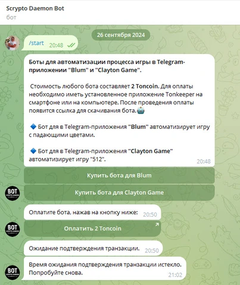

# telegram_bot_scrypto_daemon

Бот проводит пользователя через выбор приложения и оплату в TON. После нажатия кнопки он формирует ссылку Tonkeeper с комментарием платежа, запускает периодическую проверку транзакции и при подтверждении отправляет ссылку на скачивание.

**Python-портфолио Евгения Толмачева** · Python · python-telegram-bot · APScheduler · TON API · Requests



## Возможности

- Показывает меню продуктов Blum и Clayton с кнопками покупки.
- Подбирает русский или английский текст сообщений по языку пользователя Telegram.
- Формирует платёжную ссылку с суммой и комментарием, содержащим идентификатор покупателя.
- Проверяет сумму и комментарий входящей транзакции, завершает ожидание по таймауту.
- После подтверждения отправляет ссылку на выбранное приложение и снимает задачу проверки.

## Как устроен проект

### Диалог покупки

`telegram_bot_scrypto_daemon.py`

start, buy_bot и buy_bot_clayton формируют меню, локализованные сообщения и платёжную ссылку.

### Проверка транзакции

`telegram_bot_scrypto_daemon.py`

check_payment_status обращается к TON API и сопоставляет сумму, комментарий и идентификатор транзакции.

### Расписание и выдача

`telegram_bot_scrypto_daemon.py`

APScheduler запускает повторные проверки и таймаут. check_payment отправляет ссылку на приложение после подтверждения.

## Технологии и их роль

- **python-telegram-bot**: Асинхронные обработчики сообщений и inline-кнопок.
- **APScheduler**: Периодическая проверка и ограничение времени ожидания оплаты.
- **Requests и TON API**: Получение информации о входящих переводах.
- **Tonkeeper URL**: Открытие кошелька с заполненными параметрами платежа.

## Что смотреть в коде

Основной файл удобно читать от buy_bot к check_payment и check_payment_status: они связывают пользовательский диалог, расписание проверок и выдачу результата.

## Структура

```text
telegram_bot_scrypto_daemon/
├── docs/
│   └── preview.webp
├── .env.example
├── .gitignore
├── README.md
├── README.public.md
├── requirements.txt
└── telegram_bot_scrypto_daemon.py
```

## Подготовка и запуск

Это сохранённая версия пет-проекта, показывающая этап развития навыков. Для воспроизведения создайте отдельное окружение Python, совместимое с зафиксированными зависимостями:

```powershell
python -m venv .venv
.venv\Scripts\Activate.ps1
python -m pip install -r requirements.txt
```

Задайте переменные из .env.example и свой адрес вместо YOUR_TON_WALLET_ADDRESS. Файлы продуктов и рабочие настройки исключены. Платёжный сценарий сохранён как историческая интеграция и требует отдельной проверки перед практическим использованием.

Переменные окружения: `TELEGRAM_BOT_TOKEN`, `TELEGRAM_LOG_BOT_TOKEN`, `TELEGRAM_LOG_CHAT_ID`. Образец находится в [.env.example](.env.example). Сам файл .env автоматически не загружается: исходники читают окружение процесса. Значения нужно передать перед запуском, например в PowerShell:

```powershell
$env:TELEGRAM_BOT_TOKEN = "YOUR_VALUE"
```

После подготовки настроек и необходимых данных основная точка входа:

```powershell
python telegram_bot_scrypto_daemon.py
```

`requirements.txt` сохранён из проекта. Это снимок окружения, а не гарантия совместимости с новейшей версией Python. Для старых проектов могут потребоваться соответствующая версия Python и настройка системных компонентов.

## Контекст проекта

Проект 2024 года объединяет Telegram-диалог и внешнюю платёжную интеграцию. Он показывает обработку callback-кнопок, отложенные задачи и смену состояния покупки. Сценарий проверки платежа реализован в коде бота без отдельного веб-сервера.

## Состав публикации

В репозитории оставлены авторские исходники, зависимости и один компактный скриншот. Виртуальные окружения, сторонние библиотеки, рабочие базы, модели, большие наборы данных и персональные настройки не включены.

Чувствительные значения заменены понятными заглушками `YOUR_...` / `REDACTED_...`. Настоящие доступы не следует добавлять в Git. Алгоритмы и структура проекта при подготовке публикации не перерабатывались.

Проверена синтаксическая корректность Python-файлов и выполнено сканирование публикуемой копии на секреты. Полный запуск с внешними API, платежами, биржевыми операциями и локальными моделями не выполнялся.

Автор: [Евгений Толмачев](https://github.com/EvgenyET) · [Портфолио](https://evgeny.tech/)
